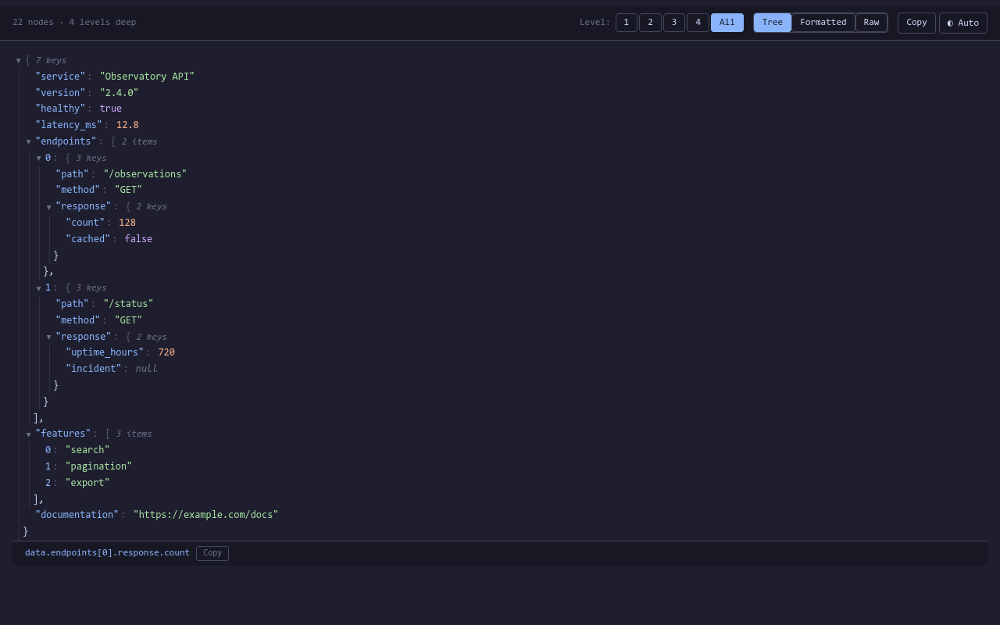

# JSON Formatter for Firefox


Read JSON responses in a collapsible tree with syntax highlighting, property paths,
and light and dark themes. Built with vanilla JavaScript and CSS, with no runtime
dependencies or data collection.

Version 1.0.2 is prepared for the first public Mozilla Add-ons (AMO) listing.
The public listing URL will be added after Mozilla publishes it.

## Features

- Syntax highlighting for keys, strings, numbers, booleans, and null in the tree.
- Collapsible objects and arrays, depth controls, and expand-all controls.
- Property paths on hover; click a row to pin a path, then copy it.
- Tree, formatted (pretty-printed), and raw (minified) views.
- Copy the full JSON document or a nested object with children.
- Light, dark, and automatic system themes.
- Indent guides and clickable HTTP/HTTPS values.
- Console access as `window.data` and `window.jsonData`, where page policy permits.



## Installation and setup

Install the signed extension from Mozilla Add-ons once the public listing is
available. Packages ending in `-unsigned.xpi` are for uploading to AMO and cannot
be permanently installed in normal Firefox.

Firefox's built-in JSON viewer can take precedence over the extension. On
Firefox desktop, open `about:config`, find `devtools.jsonview.enabled`, set it to
`false`, and reload your JSON tab. This extension does not change Firefox
preferences. Set it back to `true` to restore the built-in viewer.

Firefox may ask you to allow access to websites. Grant access on the sites where
you want JSON Formatter to run. For local JSON files, also allow access to file
URLs if Firefox offers that option.

To try a development checkout:

1. Open `about:debugging#/runtime/this-firefox`.
2. Choose **Load Temporary Add-on** and select `manifest.json`.
3. Complete the setup above and open a JSON response.

Temporary installations are removed when Firefox restarts.

## Usage

The extension activates on valid JSON objects or arrays served with a JSON content
type, or on a page consisting of a single `<pre>` containing JSON. Ordinary HTML,
invalid JSON, and top-level primitive values are left unchanged. Inputs longer
than 10,485,760 JavaScript string characters are skipped to limit resource use.

- **Tree / Formatted / Raw** switches the view.
- **Level** buttons expand to a selected depth; **All** expands the tree.
- Click the triangle beside an object or array to collapse it.
- Hover a row to inspect its path. Click to pin it; **Escape** clears the pin.
- Hover a nested object to reveal its copy and expand/collapse-children controls.
- **Copy** copies the formatted document. Clipboard access depends on the page
  context and Firefox's clipboard rules.
- The theme button cycles **Auto → Dark → Light**. Your choice is stored per site
  in local storage when available.

In the page's console, `window.data` and `window.jsonData` expose the parsed
document when inline scripts are permitted by the page's Content Security Policy.

## Compatibility and permissions

The manifest supports Firefox **140+ on desktop** and **142+ on Android** using
Manifest V3. Desktop is the primary tested platform; Android still needs a device
check before being advertised as tested.

Access to all websites lets the content script detect JSON responses at arbitrary
URLs. It inspects eligible documents locally and leaves other pages unchanged.
There is no background service, analytics, telemetry, or remote code. See
[the privacy policy](PRIVACY.md) for theme storage and clipboard details.

## Development and releases

The extension itself needs no build step. Python 3 and Node.js 22+ are used by the
release tools.

```sh
npm ci
make release
```

This verifies the manifest, stages an allowlist of runtime files, creates an
unsigned XPI and listing kit in `dist/`, and runs Mozilla's web-ext validator.
See [the publishing guide](PUBLISHING.md) for signing, public submission, the old
private update channel, and the release checklist.

```sh
make icons                       # Regenerate PNGs; requires rsvg-convert
npx playwright install firefox   # One-time screenshot browser setup
npm run screenshots              # Firefox smoke checks and real UI captures
```

Edit `content-script.js` for behavior, `styles.css` for themes, and
`icons/icon.svg` for the icon. Generated PNGs and listing screenshots are committed
so packaging does not need an image renderer or browser.

Report issues and request features at
[GitHub Issues](https://github.com/MohamedElashri/json-formatter/issues).
Contributions are welcome. Licensed under [MIT](LICENSE).
